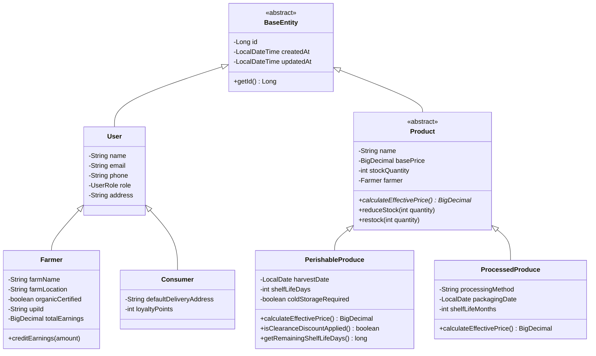
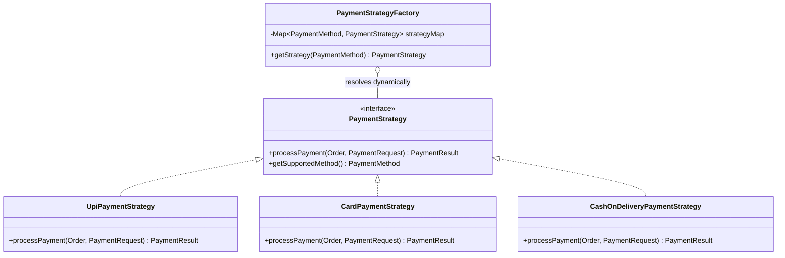

# FarmDirect — Direct Producer-to-Consumer Online Shopping System
## Academic Presentation & Defense Deck (Java OOP & UN SDG Alignment)

---

### Slide 1: Title Slide
* **Project Title:** FarmDirect — Direct Producer-to-Consumer Online Shopping System
* **Sub-title:** An Object-Oriented Java & Spring Boot Application Aligned with UN Sustainable Development Goals (SDG 2 & SDG 12)
* **Domain:** E-Commerce / Agricultural Supply Chain
* **Course:** Object-Oriented Programming (OOP) in Java
* **Tech Stack:** Java 21, Spring Boot 3.4.2, React 18, Tailwind CSS, Spring Data JPA, H2 In-Memory DB, SpringDoc OpenAPI (Swagger UI)
* **Presenter / Student:** [Your Name / Roll No / Department]
* **Instructor / Guide:** [Professor / Evaluator Name]

---

### Slide 2: a) Abstract
* **Core Summary:** 
  FarmDirect is a specialized online shopping platform engineered to eliminate intermediate agricultural brokers (middlemen) who extract 40%–70% of harvest value. It directly connects smallholder farmers with end consumers.
* **Key Innovations:**
  1. **Guaranteed Fair Remuneration:** Implements a direct revenue model where **90% of checkout value** is directly disbursed to the producer's bank account.
  2. **Automated Food Waste Prevention:** Employs a dynamic freshness-saver algorithm that triggers a **25% clearance discount** on perishable goods during their final 35% of shelf life.
* **OOP Engineering:** 
  Architected on the four core pillars of Object-Oriented Programming (Encapsulation, Inheritance, Polymorphism, Abstraction) and the Strategy Design Pattern.
* **Outcome:** 
  A fully operational, plug-and-play fullstack system with an interactive React frontend, Spring Boot REST backend, automated H2 database, and Swagger documentation.

---

### Slide 3: b) Introduction — 1. Purpose of the System
* **Primary Mission:** Democratize farm commerce by removing predatory middlemen and creating an equitable digital marketplace.
* **Key Purposes:**
  * **Farmer Empowerment:** Grant smallholder producers direct price-setting capability and immediate digital revenue settlement (via UPI/Card).
  * **Consumer Transparency:** Provide consumers with farm-origin traceability, harvest dates, cold-chain status, and pesticide-free certifications.
  * **Food Waste Mitigation:** Systematically reduce supply-chain produce spoilage by incentivizing timely consumer purchases through algorithmic discounts.
  * **Academic Demonstration:** Provide an exemplar of enterprise OOP architecture applied to real-world socio-economic problems.

---

### Slide 4: b) Introduction — 2. Relevance and Scope of the System
* **Relevance to UN Sustainable Development Goals (SDGs):**
  * **SDG 2: Zero Hunger (Target 2.3):** Double agricultural productivity and incomes of small-scale food producers through secure, unmediated market access.
  * **SDG 12: Responsible Consumption & Production (Target 12.3):** Halve per capita food waste at retail and consumer levels and minimize post-harvest agricultural losses.
* **Scope of the Current System:**
  * **Producer Portal:** Listing of perishable produce (with harvest dates and shelf-life tracking) and artisanal processed goods.
  * **Consumer Marketplace:** Search, filter, dynamic pricing badges, and organic certification tags.
  * **Shopping Cart Engine:** Live computation of item totals, 90% direct farmer payout share, and estimated middleman savings.
  * **Polymorphic Checkout:** Flexible payments via UPI, Credit/Debit Card, and Cash on Delivery.
  * **Invoice & SDG Analytics:** Digital receipts and live metrics tracking farmer earnings and kilograms of produce saved from spoilage.

---

### Slide 5: c) Problem Definition — 1. Problem Statement
* **The Intermediary Trap in Traditional Agriculture:**
  * **Disproportionate Margins:** In conventional food distribution, 4 to 6 layers of brokers, commission agents (Arhtiyas), and wholesale distributors inflate retail prices while paying farmers bottom-dollar rates.
  * **High Post-Harvest Spoilage:** Long warehouse transit and bureaucratic supply chains result in an estimated 30%–40% loss of fresh fruits and vegetables before reaching consumers.
  * **Information Asymmetry:** Consumers have no visibility into how old their produce is or whether the farmer was fairly compensated.
  * **Cash Flow Delays:** Small farmers frequently wait 30–90 days for wholesale consignments to clear, leading to crippling seasonal debt.

---

### Slide 6: c) Problem Definition — 2. Objectives
* **Technical & Engineering Objectives:**
  * **Objective 1:** Implement strict **OOP Encapsulation** across all domain entities (`Product`, `Cart`, `Order`, `Payment`) ensuring state consistency and stock validation.
  * **Objective 2:** Design an extensible **Inheritance Hierarchy** extending `BaseEntity` and partitioning `Product` into `PerishableProduce` and `ProcessedProduce`.
  * **Objective 3:** Implement runtime **Polymorphism** via the Strategy Pattern for multi-channel payment processing (UPI, Card, COD) and dynamic freshness discounting.
  * **Objective 4:** Provide pure **Service Abstraction** decoupling API controllers from underlying JPA data access.
* **Societal & SDG Objectives:**
  * Guarantee an immutable 90% direct revenue share to producers.
  * Enforce automated clearance discounts on near-expiry produce to combat retail food waste.
  * Provide zero-setup plug-and-play execution using an in-memory database.

---

### Slide 7: d) Requirement Analysis
* **Functional Requirements (FR):**
  * **FR1 (Catalog Management):** Browse, filter by category (`VEGETABLES`, `FRUITS`, `GRAINS`, `HONEY`, etc.), search by produce/farm name, and list new produce items.
  * **FR2 (Cart Management):** Add produce, update quantities with inventory bounds check, remove items, calculate 90% farmer payout share and consumer savings.
  * **FR3 (Order Processing & Checkout):** Validate stock, deduct inventory atomically, execute selected payment strategy, record immutable invoice, credit farmer balances.
  * **FR4 (SDG Impact Tracking):** Aggregate real-time metrics on total farmer payouts, broker commissions bypassed, and kilograms of food waste prevented.
* **Non-Functional Requirements (NFR):**
  * **Performance & Scalability:** Sub-100ms response times on H2 in-memory queries.
  * **Data Integrity:** Synchronized stock deduction preventing race conditions and overselling.
  * **Maintainability & Clean Architecture:** Tiered separation (Controller -> Service -> Repository -> Domain).
  * **Zero Setup Overhead:** In-memory H2 DB requires no local MySQL/PostgreSQL installation.

---

### Slide 8: e) System Design — Tiered Architecture
```
┌──────────────────────────────────────────────────────────┐
│             Presentation Tier: React 18 + Vite           │
│  Tailwind CSS • Lucide Icons • Responsive SPA Dashboard  │
└────────────────────────────┬─────────────────────────────┘
                             │ REST API (JSON / HTTP)
┌────────────────────────────▼─────────────────────────────┐
│          API Controller Tier: Spring Boot Web MVC         │
│  ProductController • CartController • OrderController    │
│  SdgImpactController • GlobalExceptionHandler            │
└────────────────────────────┬─────────────────────────────┘
                             │ Service Abstraction
┌────────────────────────────▼─────────────────────────────┐
│            Business Logic Tier (Service Interfaces)      │
│  ProductService • CartService • OrderService             │
│  PaymentService • PaymentStrategyFactory (Strategy)      │
└────────────────────────────┬─────────────────────────────┘
                             │ Domain & Persistence
┌────────────────────────────▼─────────────────────────────┐
│       Domain & JPA Repository Tier (Spring Data JPA)     │
│  Entities: BaseEntity, Product, Perishable, Processed,   │
│            User, Farmer, Consumer, Cart, Order, Payment  │
└────────────────────────────┬─────────────────────────────┘
                             │ In-Memory JDBC
┌────────────────────────────▼─────────────────────────────┐
│         Database: H2 In-Memory Database (Embedded)       │
└──────────────────────────────────────────────────────────┘
```

---

### Slide 9: e) System Design — Class Diagram (OOP Pillars)


---

### Slide 10: e) System Design — Polymorphic Strategy Pattern (Payments)


---

### Slide 11: f) Code Snippets — 1. Encapsulation & Domain Validation
```java
// Product.java: Protected state mutation and business validation
@Entity
@Table(name = "products")
public abstract class Product extends BaseEntity {
    @NotNull(message = "Base price is required")
    @DecimalMin(value = "0.01", message = "Price must be greater than zero")
    private BigDecimal basePrice;

    @Min(value = 0, message = "Stock quantity cannot be negative")
    private int stockQuantity;

    public synchronized void reduceStock(int quantity) {
        if (quantity <= 0) {
            throw new IllegalArgumentException("Quantity must be positive.");
        }
        if (this.stockQuantity < quantity) {
            throw new InsufficientStockException(
                "Insufficient stock for produce '" + this.name + 
                "'. Available: " + this.stockQuantity + ", Requested: " + quantity
            );
        }
        this.stockQuantity -= quantity;
    }
}
```
* **OOP Principle:** Protects internal inventory integrity against race conditions and invalid deficits.

---

### Slide 12: f) Code Snippets — 2. Polymorphic Dynamic Freshness Pricing
```java
// PerishableProduce.java: Dynamic 25% discount for near-expiry items (SDG 12.3)
@Entity
@DiscriminatorValue("PERISHABLE")
public class PerishableProduce extends Product {
    private LocalDate harvestDate;
    private int shelfLifeDays;

    public long getRemainingShelfLifeDays() {
        long daysSinceHarvest = ChronoUnit.DAYS.between(harvestDate, LocalDate.now());
        return Math.max(0, shelfLifeDays - daysSinceHarvest);
    }

    @Override
    public boolean isClearanceDiscountApplied() {
        long remaining = getRemainingShelfLifeDays();
        // Applies discount when 35% or less shelf life remains to eliminate waste
        return remaining > 0 && remaining <= Math.ceil(shelfLifeDays * 0.35);
    }

    @Override
    public BigDecimal calculateEffectivePrice() {
        if (isClearanceDiscountApplied()) {
            return getBasePrice().multiply(new BigDecimal("0.75"))
                                 .setScale(2, RoundingMode.HALF_UP);
        }
        return getBasePrice().setScale(2, RoundingMode.HALF_UP);
    }
}
```
* **OOP Principle:** Polymorphic override calculates live clearance rates dynamically without brittle `if-else` type inspections.

---

### Slide 13: f) Code Snippets — 3. Polymorphic Strategy Pattern (Payments)
```java
// PaymentStrategyFactory.java: Decoupled strategy resolution
@Component
public class PaymentStrategyFactory {
    private final Map<PaymentMethod, PaymentStrategy> strategyMap = 
        new EnumMap<>(PaymentMethod.class);

    public PaymentStrategyFactory(List<PaymentStrategy> strategies) {
        for (PaymentStrategy strategy : strategies) {
            strategyMap.put(strategy.getSupportedMethod(), strategy);
        }
        // DEBIT_CARD reuses tokenized card processing
        strategyMap.put(PaymentMethod.DEBIT_CARD, strategyMap.get(PaymentMethod.CREDIT_CARD));
    }

    public PaymentStrategy getStrategy(PaymentMethod method) {
        PaymentStrategy strategy = strategyMap.get(method);
        if (strategy == null) {
            throw new PaymentProcessingException("Unsupported method: " + method);
        }
        return strategy;
    }
}
```
* **OOP Principle:** Open-Closed Principle (OCP) and Polymorphism; new payment modes (e.g. Crypto/Wallets) can be plugged in without modifying order logic.

---

### Slide 14: f) Code Snippets — 4. Abstraction & Transaction Management
```java
// OrderServiceImpl.java: Abstraction of checkout transaction
@Service
@Transactional
public class OrderServiceImpl implements OrderService {
    @Override
    public OrderResponse checkoutCart(CheckoutRequest request) {
        Cart cart = cartRepository.findByUserId(request.getUserId())
            .orElseThrow(() -> new ResourceNotFoundException("Cart not found"));

        Order order = new Order(generateOrderNumber(), cart.getUser(), 
                                request.getDeliveryAddress(), request.getPayment().getPaymentMethod());

        // Atomic inventory deduction & order item snapshot
        for (CartItem item : cart.getItems()) {
            Product product = item.getProduct();
            product.reduceStock(item.getQuantity());
            productRepository.save(product);
            order.addItem(new OrderItem(order, product, item.getQuantity(), item.getUnitPrice()));
        }

        // Polymorphic Payment Execution
        PaymentResult result = paymentService.processOrderPayment(order, request.getPayment());

        // Direct Producer Remuneration (SDG 2.3)
        for (OrderItem item : order.getItems()) {
            farmerRepository.findById(item.getFarmerId()).ifPresent(farmer -> {
                farmer.creditEarnings(item.getFarmerEarning()); // 90% direct payout
                farmerRepository.save(farmer);
            });
        }
        cart.clear();
        return OrderResponse.fromEntity(orderRepository.save(order));
    }
}
```

---

### Slide 15: g) Output Screenshots & Visual Demonstration

| Screen / Feature | What It Displays | Societal / OOP Significance |
| :--- | :--- | :--- |
| **1. Home & Hero Dashboard** | Live UN SDG metrics strip, value propositions, and academic OOP matrix. | Communicates real-time farmer earnings and food waste prevented. |
| **2. Produce Marketplace** | Catalog grid with category filter pills, organic tags, search bar, and live shelf-life badges. | Shows dynamic pricing with strikethrough base prices on clearance items. |
| **3. Freshness-Saver Filter** | Dedicated toggle highlighting produce with active 25% waste discounts. | Demonstrates UN SDG 12.3 in action directly in the consumer shopping experience. |
| **4. Shopping Basket** | Line items with `+/-` quantity adjusters, subtotal, 90% direct farmer share breakdown, and consumer savings. | Enforces transparent direct-to-farm revenue accounting. |
| **5. Slide-in Checkout** | Delivery address input and Polymorphic Payment Selector (UPI, Card, COD). | Visual manifestation of the backend `PaymentStrategy` pattern. |
| **6. Farm Tax Invoice Modal** | Itemized receipt with order number, line items, and producer payout breakdown. | Provides complete fiscal transparency for consumers and producers. |
| **7. Swagger UI (`/swagger-ui.html`)** | Interactive OpenAPI 3 documentation of all REST endpoints. | Enables independent API testing and contract verification. |
| **8. H2 Console (`/h2-console`)** | Embedded database tables (`products`, `orders`, `farmers`, etc.). | Proves zero-configuration in-memory persistence. |

---

### Slide 16: h) Conclusion & Future Enhancements
* **Key Achievements:**
  * Successfully developed a fullstack direct-to-consumer online shopping platform mapped to **UN SDGs 2 and 12**.
  * Complete, rigorous adherence to **Object-Oriented Programming (OOP) in Java 21**:
    * Encapsulation in robust domain entities and stock protection.
    * Multi-tier Inheritance in entities (`BaseEntity`, `User`, `Product`).
    * Polymorphic Strategy Pattern in payments and dynamic pricing algorithms.
    * Layered Abstraction separating REST controllers from JPA persistence.
  * Verified through automated unit and integration tests (11 tests, 0 failures).
* **Future Scope & Enhancements:**
  * **IoT Cold-Chain Telemetry:** Integration with temperature/humidity sensors during transit.
  * **Co-operative Micro-Logistics:** Route optimization algorithms for cluster-based electric vehicle delivery.
  * **Blockchain Traceability:** Immutable ledger recording harvest batch origins and organic certifications.

---

### Slide 17: Q&A / Thank You Slide
* **Project Name:** FarmDirect — Direct Producer-to-Consumer Online Shopping System
* **GitHub / Repository:** `c:\Users\HP\Desktop\code\uni`
* **Swagger Documentation:** `http://localhost:8080/swagger-ui.html`
* **H2 Database Console:** `http://localhost:8080/h2-console`
* **Questions & Discussion:** *Thank you! Open for questions from the evaluation committee.*
