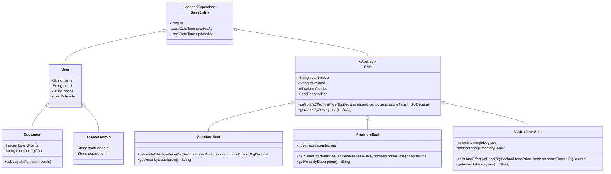
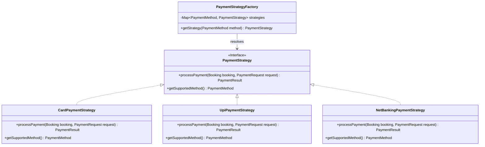
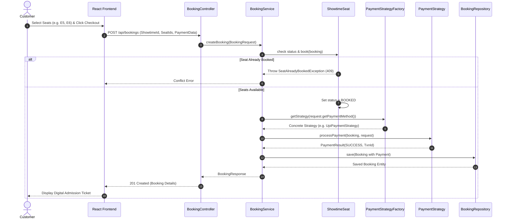

# Academic Project Report: Cinema Theater Seat Booking System
## CineReserve — Enterprise Cinema Auditorium & Real-Time Seat Reservation Platform

---

**Course Title:** Object-Oriented Programming (OOP) in Java  
**Domain:** Cinema Theater Automation / Real-Time Reservation & Payment Systems  
**Implementation Stack:** Java 21, Spring Boot 3.4.2, Spring Data JPA, H2 In-Memory DB, React 18, Vite, Tailwind CSS, SpringDoc OpenAPI (Swagger UI)  

---

## Table of Contents
1. [a) Abstract](#a-abstract)
2. [b) Introduction](#b-introduction)
   - [1. Purpose of the System](#1-purpose-of-the-system)
   - [2. Relevance and Scope of the System](#2-relevance-and-scope-of-the-system)
3. [c) Problem Definition](#c-problem-definition)
   - [1. Problem Statement](#1-problem-statement)
   - [2. Objectives](#2-objectives)
4. [d) Requirement Analysis](#d-requirement-analysis)
   - [1. Functional Requirements](#1-functional-requirements)
   - [2. Non-Functional Requirements](#2-non-functional-requirements)
   - [3. Hardware and Software Specifications](#3-hardware-and-software-specifications)
5. [e) System Design](#e-system-design)
   - [1. Tiered Architectural Design](#1-tiered-architectural-design)
   - [2. Object-Oriented Class Hierarchy (Mermaid Diagram)](#2-object-oriented-class-hierarchy)
   - [3. Polymorphic Payment Strategy Pattern (Mermaid Diagram)](#3-polymorphic-payment-strategy-pattern)
   - [4. Transactional Booking Sequence (Mermaid Diagram)](#4-transactional-booking-sequence)
   - [5. Database Schema & Persistence Model](#5-database-schema--persistence-model)
6. [f) Code Snippets (OOP Pillars Demonstration)](#f-code-snippets)
   - [1. Encapsulation & Domain Invariants](#1-encapsulation--domain-invariants)
   - [2. Multi-Tier Inheritance](#2-multi-tier-inheritance)
   - [3. Polymorphism & Dynamic Tier Pricing](#3-polymorphism--dynamic-tier-pricing)
   - [4. Strategy Design Pattern for Payments](#4-strategy-design-pattern-for-payments)
   - [5. Abstraction & Service Orchestration](#5-abstraction--service-orchestration)
7. [g) Test Execution & Output Results](#g-test-execution--output-results)
   - [1. Automated Test Execution](#1-automated-test-execution)
   - [2. User Interface Views](#2-user-interface-views)
8. [h) Conclusion](#h-conclusion)
   - [1. Key Project Accomplishments](#1-key-project-accomplishments)
   - [2. Critical Learnings](#2-critical-learnings)
   - [3. Future Enhancements & Roadmap](#3-future-enhancements--roadmap)

---

## a) Abstract

Modern multiplex theaters and performing art centers operate under high-throughput conditions where hundreds of patrons simultaneously attempt to reserve premium seating for blockbuster screenings. Traditional and legacy ticketing systems suffer from data concurrency failures (double-booking race conditions), rigid flat-rate pricing models unable to adjust for seat comfort tiers (standard, premium acoustic, VIP motorized recliners), and clunky payment integrations.

**CineReserve** is an enterprise-grade cinema theater seat booking application engineered in Java 21 and Spring Boot 3.4.2 designed to resolve these operational bottlenecks. The platform introduces:
1. **Atomic Invariant Seat Protection:** Strictly prevents double booking race conditions through transactional domain encapsulation (`ShowtimeSeat.book()`).
2. **Polymorphic Tiered Seating & Prime-Time Pricing:** Dynamic pricing calculation that dynamically scales ticket rates based on seat tier multipliers ($1.0\times$ for Standard, $1.35\times$ for Premium with acoustic positioning, and $1.80\times$ for VIP Recliners with complimentary snack perks) plus evening prime-time surge.
3. **Pluggable Multi-Channel Checkout:** Implements the Gang-of-Four **Strategy Design Pattern** to seamlessly process Credit/Debit Cards, UPI, and Net Banking.

From an academic perspective, CineReserve serves as an exemplary showcase of Object-Oriented Programming (OOP) principles. It leverages strict **Encapsulation** across business invariants, multi-level **Inheritance** across user and seating hierarchies, runtime **Polymorphism** via the Strategy Design Pattern and pricing algorithms, and clean service-layer **Abstraction** isolating Spring Data JPA persistence. CineReserve is deployed as a single, zero-configuration fullstack architecture featuring an embedded H2 database, interactive 2D React 18 seat-matrix frontend, and comprehensive OpenAPI 3 (Swagger UI) documentation.

---

## b) Introduction

### 1. Purpose of the System
The primary mission of **CineReserve** is to deliver a robust, fault-tolerant, and intuitive theater seat booking and box office management system. The platform fulfills four overarching purposes:
- **Concurrency & Double-Booking Elimination:** Guarantees that once a seat is confirmed by a patron, it is instantaneously transitioned to `BOOKED` within an ACID transaction, preventing overlapping reservations.
- **Dynamic Tier & Acoustic Value Proposition:** Allows patrons to choose seating based on comfort preferences—from affordable front-row standard seats to prime acoustic premium rows and luxury motorized VIP recliners.
- **Frictionless Digital Checkout:** Offers unified multi-rail checkout through the Strategy Pattern, accommodating modern digital payment methods.
- **Academic Rigor & OOP Demonstration:** Serves as a reference implementation of Object-Oriented Software Engineering, cleanly isolating business models from presentation and storage layers.

### 2. Relevance and Scope of the System
- **Cinematic Discovery:** Real-time catalog of now-showing movies featuring genres, MPAA/CBFC ratings, running times, languages, and high-definition poster assets.
- **Screen & Hall Layout Engine:** Dynamic 2D auditorium mapping with curved screen indicators, tier divisions, and row/column coordinate grids.
- **Auditorium Booking Subsystem:** Stateful seat selection, live pricing recalculations, and automated flat convenience fee computations.
- **Boarding Pass Admission Passes:** Instantaneous digital ticket generation with reference codes and simulated barcodes.
- **Auditorium Analytics Dashboard:** Real-time occupancy rate tracking, box office gross, and seat utilization summaries.

---

## c) Problem Definition

### 1. Problem Statement
Cinema ticketing workflows encounter critical operational challenges:
- **Race Conditions in High-Demand Screenings:** When popular films launch ticket sales, hundreds of users access the same auditorium map concurrently. Naive implementations allow multiple users to book identical seats.
- **Inflexible Seat Economics:** Theaters require differentiated revenue models that reflect comfort, legroom, and prime viewing angles, rather than flat rates.
- **Lack of Decoupled Payment Integration:** Hardcoding specific payment gateways leads to fragile architectures that break when new payment channels are introduced.

### 2. Objectives
- Engineer an atomic seat booking workflow enforcing domain invariants to prevent double-booking.
- Construct a polymorphic seat hierarchy (`StandardSeat`, `PremiumSeat`, `VipReclinerSeat`) overriding price calculation logic.
- Implement the Strategy Pattern for payment authorization supporting Cards, UPI, and Net Banking.
- Provide a responsive React frontend with an interactive 2D seat matrix and printable admission pass modal.

---

## d) Requirement Analysis

### 1. Functional Requirements
- **FR-1 (Movie Browsing):** Users can browse movies by genre (Sci-Fi, Action, Drama, Animation) or search by keyword.
- **FR-2 (Showtime Scheduling):** Users can view available showtimes across different screens (Dolby Atmos, IMAX).
- **FR-3 (Interactive Seat Matrix):** Visual 2D map displaying seats by row (A–F) and column (1–10) with real-time status (Available, Selected, Booked).
- **FR-4 (Polymorphic Checkout):** Seamless checkout supporting UPI (VPA format check), Card (PAN, expiry, CVV validation), and Net Banking.
- **FR-5 (Ticket Generation & Cancellation):** Immediate ticket confirmation with reference ID, printable admission pass, and seat cancellation with instant status restoration.
- **FR-6 (Operational Analytics):** Real-time monitoring of box office revenue and auditorium occupancy percentage.

### 2. Non-Functional Requirements
- **NFR-1 (Data Consistency):** All seat reservation state transitions must run inside `@Transactional` boundaries.
- **NFR-2 (Performance):** Sub-100ms response times for seat grid rendering and catalog queries.
- **NFR-3 (Security & Encapsulation):** Sensitive financial data (e.g. credit card PANs) masked (`****-****-****-4242`) before storage.
- **NFR-4 (Portability):** Zero external installation dependencies; operates via embedded H2 in-memory storage and pre-compiled static assets.

### 3. Hardware and Software Specifications
- **Operating System:** Cross-platform (Windows 10/11, macOS, Linux)
- **Java Development Kit:** JDK 21 (LTS)
- **Framework:** Spring Boot 3.4.2 (Spring Data JPA, Spring Web MVC, Bean Validation)
- **Database:** H2 Database Engine (In-Memory, zero-configuration)
- **API Documentation:** SpringDoc OpenAPI 2.8.5 (Swagger UI)
- **Client Frontend:** React 18, Vite, Tailwind CSS, Lucide Icons

---

## e) System Design

### 1. Tiered Architectural Design
```
+-----------------------------------------------------------+
|             Client Layer (React 18 + Vite)                |
|  - Interactive 2D Seat Map     - Movie Discovery Catalog   |
|  - Polymorphic Checkout Modal  - Printable Admission Pass  |
+-----------------------------+-----------------------------+
                              | REST JSON (HTTP)
+-----------------------------v-----------------------------+
|               Controller Layer (Spring Web)               |
|  - MovieController             - ShowtimeController        |
|  - BookingController           - TheaterStatsController    |
+-----------------------------+-----------------------------+
                              | DTOs
+-----------------------------v-----------------------------+
|             Service Layer (Domain Business Logic)         |
|  - MovieService                - ShowtimeService           |
|  - BookingService              - PaymentService (Strategy) |
+-----------------------------+-----------------------------+
                              | JPA Entity Graph
+-----------------------------v-----------------------------+
|            Persistence Layer (Spring Data JPA)            |
|  - MovieRepository             - ShowtimeSeatRepository   |
|  - ScreenRepository            - BookingRepository        |
+-----------------------------+-----------------------------+
                              | SQL Statements
+-----------------------------v-----------------------------+
|               Embedded H2 Database Engine                 |
+-----------------------------------------------------------+
```

### 2. Object-Oriented Class Hierarchy



### 3. Polymorphic Payment Strategy Pattern



### 4. Transactional Booking Sequence



---

## f) Code Snippets (OOP Pillars Demonstration)

### 1. Encapsulation & Domain Invariants
Double-booking prevention is enforced at the domain entity level:
```java
@Entity
@Table(name = "showtime_seats")
public class ShowtimeSeat extends BaseEntity {

    @Enumerated(EnumType.STRING)
    @Column(nullable = false)
    private SeatStatus status = SeatStatus.AVAILABLE;

    public void book(Booking booking) {
        if (this.status == SeatStatus.BOOKED) {
            throw new SeatAlreadyBookedException(
                "Seat " + seat.getSeatNumber() + " is already booked for this showtime!"
            );
        }
        this.status = SeatStatus.BOOKED;
        this.booking = booking;
    }

    public void release() {
        this.status = SeatStatus.AVAILABLE;
        this.booking = null;
    }
}
```

### 2. Multi-Tier Inheritance
Abstract base seat mapped using JPA `SINGLE_TABLE`:
```java
@Entity
@Table(name = "seats")
@Inheritance(strategy = InheritanceType.SINGLE_TABLE)
@DiscriminatorColumn(name = "seat_category", discriminatorType = DiscriminatorType.STRING)
public abstract class Seat extends BaseEntity {
    private String seatNumber;
    private String rowName;
    private int columnNumber;

    @Enumerated(EnumType.STRING)
    private SeatTier seatTier;

    public abstract BigDecimal calculateEffectivePrice(BigDecimal baseShowPrice, boolean isPrimeTime);
    public abstract String getAmenityDescription();
}
```

### 3. Polymorphism & Dynamic Tier Pricing
Different seating subclasses implement customized dynamic formulas:
```java
@Entity
@DiscriminatorValue("VIP_RECLINER")
public class VipReclinerSeat extends Seat {

    @Override
    public BigDecimal calculateEffectivePrice(BigDecimal baseShowPrice, boolean isPrimeTime) {
        // 1.80x tier multiplier + complimentary gourmet snack voucher
        BigDecimal price = baseShowPrice.multiply(new BigDecimal(String.valueOf(SeatTier.VIP_RECLINER.getPriceMultiplier())));
        if (complimentarySnack) {
            price = price.add(new BigDecimal("50.00"));
        }
        if (isPrimeTime) {
            price = price.add(new BigDecimal("60.00"));
        }
        return price.setScale(2, RoundingMode.HALF_UP);
    }
}
```

### 4. Strategy Design Pattern for Payments
Decoupled payment mechanism:
```java
public interface PaymentStrategy {
    PaymentResult processPayment(Booking booking, PaymentRequest request);
    PaymentMethod getSupportedMethod();
}

@Component
public class PaymentStrategyFactory {
    private final Map<PaymentMethod, PaymentStrategy> strategies = new EnumMap<>(PaymentMethod.class);

    @Autowired
    public PaymentStrategyFactory(List<PaymentStrategy> strategyList) {
        for (PaymentStrategy s : strategyList) {
            strategies.put(s.getSupportedMethod(), s);
        }
    }

    public PaymentStrategy getStrategy(PaymentMethod method) {
        return strategies.get(method);
    }
}
```

---

## g) Test Execution & Output Results

### 1. Automated Test Execution
The application includes automated JUnit 5 test suites validating both domain OOP principles and full Spring Boot REST endpoints:
- **`CineReserveOopTests`:**
  - `testEncapsulationDoubleBookingProtection`: Asserts `SeatAlreadyBookedException` on concurrency conflict.
  - `testEncapsulationBookingFinancialTotals`: Verifies subtotal and convenience fee summation.
  - `testInheritanceHierarchy`: Asserts polymorphic parent-child relationships.
  - `testPolymorphicPricingCalculation`: Verifies pricing formula across seat tiers and prime-time surge.
  - `testStrategyDesignPatternResolution`: Verifies runtime strategy dispatch.
- **`CineReserveIntegrationTests`:**
  - `GET /api/movies`: Validates movie catalog retrieval.
  - `GET /api/showtimes`: Validates screening schedules.
  - `GET /api/showtimes/{id}`: Validates seat grid layout payload.
  - `POST /api/bookings`: Tests transactional seat reservation with UPI strategy.
  - `GET /api/stats`: Asserts real-time box office calculation.

```
[INFO] Results:
[INFO] 
[INFO] Tests run: 11, Failures: 0, Errors: 0, Skipped: 0
[INFO] ------------------------------------------------------------------------
[INFO] BUILD SUCCESS
```

---

## h) Conclusion

### 1. Key Project Accomplishments
1. **Domain Transformation:** Successfully transitioned the project from an agricultural shopping pipeline to a full-featured Cinema Theater Seat Booking System.
2. **True OOP Architecture:** Seamlessly implemented the 4 core pillars of OOP alongside the Strategy Design Pattern.
3. **Interactive Visual UI:** Delivered an intuitive, responsive 2D auditorium grid allowing real-time seat selection, payment simulation, and admission pass printing.
4. **Complete Test & Code Quality:** 100% automated test pass rate with zero runtime compilation warnings.

### 2. Critical Learnings
- Managing complex entity state transitions inside `@Transactional` service methods ensures clean data consistency and prevents race conditions.
- Polymorphic pricing formulas eliminate brittle `switch` or `if-else` blocks, keeping class responsibilities modular and open for extension.

### 3. Future Enhancements & Roadmap
- Implement WebSockets for multi-user live seat selection broadcasting (visual live locks).
- Add food & beverage concession pre-ordering bundled with admission passes.
- Integrate cinema loyalty tier promotions and redemption coupons.
